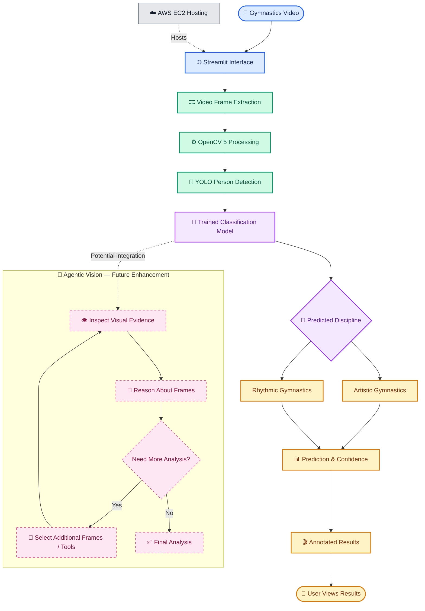

# Gymnalyze 🏅

**AI-powered gymnastics video classification and analysis using computer
vision, Agentic Vision, and AWS.**

Gymnalyze is a web-based prototype for analyzing gymnastics videos and
predicting a gymnastics category such as **artistic, rhythmic, or
acrobatic gymnastics**. It combines a trained YOLO-based model and
video-processing utilities with an interactive Streamlit application.
The project explores how computer vision and an Agentic Vision workflow
can help make sports-video analysis more accessible.

> **Project status:** Research and prototype. Model predictions depend
> on training data, video quality, and generalization to unseen footage;
> they should not be treated as guaranteed ground truth.

## ✨ Features

-   **Video upload and analysis** through a Streamlit web interface.
-   **AI-based category prediction** using the project's trained model.
-   **Frame-level video processing** with OpenCV.
-   **YOLO-based inference** for the project's computer-vision workflow.
-   **Agentic Vision workflow** to support a structured
    analyze--interpret--respond process.
-   **Video conversion and output handling** with FFmpeg where required.
-   **Cloud-hosted application** deployed on Amazon EC2.
-   **Object storage** using Amazon S3 for project artifacts or
    video/model assets, according to the configured workflow.
-   **Cloud monitoring** with Amazon CloudWatch for operational
    visibility, where configured.

## 🧠 Agentic Vision with OpenCV 5

Gymnalyze explores an **Agentic Vision** approach: rather than treating
video analysis as a single opaque step, the workflow can be organized
into stages that inspect input video, extract useful visual information,
run model inference, and present a result for the user.

OpenCV 5 is the computer-vision layer for video/frame handling in the
intended workflow. The YOLO model provides the learned visual inference
component. The agentic layer coordinates the analysis steps and result
handling; it does not make model predictions inherently correct, and any
confidence or review indicators should be interpreted as signals rather
than guarantees.

### High-level architecture


## 🏗️ Gymnalyze — System Architecture



### 🔍 Architecture Notes

- **OpenCV 5:** Handles video reading and frame processing.
- **YOLO:** Detects people in the video.
- **Classification model:** Predicts artistic or rhythmic gymnastics.
- **Streamlit:** Provides the user interface.
- **AWS EC2:** Hosts the deployed application.
- **Agentic Vision:** The dashed pink section represents a proposed enhancement for reasoning over visual evidence and choosing additional analysis steps; it should not be presented as implemented until that workflow is integrated.
- **Webcam limitation:** Browser-based live webcam analysis is still under development; the current workflow uses uploaded or sample videos.


**Diagram note:** This is a logical architecture diagram. Exact data
paths and the extent of S3/CloudWatch integration depend on the deployed
configuration. Only describe components as active integrations if they
are configured in the running AWS environment.

## ☁️ AWS Deployment

Gymnalyze is hosted on **Amazon EC2**, which runs the Streamlit
application. The application can be managed as a `systemd` service so
that it runs in the background and is configured to restart after a
process failure or instance reboot.

The cloud architecture can use the following AWS services:

-   **Amazon EC2:** Hosts the web application and inference workflow.
-   **Amazon S3:** Stores selected project artifacts, such as model
    files or uploaded/processed assets, when the configured application
    workflow uses S3.
-   **Amazon CloudWatch:** Provides monitoring and log visibility for
    configured AWS resources. Application-level logs can also be
    inspected through `systemd`/`journalctl` on the instance.

### Deployment considerations

-   Keep the EC2 instance running while the demo must be available.
-   A public IPv4 address can change after a stop/start cycle unless a
    stable address is configured.
-   Restrict inbound rules to the required ports and intended users.
-   Do not commit AWS credentials, private keys, `.env` files, or other
    secrets to the repository.
-   For a production deployment, put the app behind HTTPS and consider
    authentication and upload-size limits.
-   Check AWS billing and resource usage regularly.

## 🧰 Tech Stack

-   **Language:** Python
-   **Web application:** Streamlit
-   **Computer vision:** OpenCV 5 (use the version installed in the
    deployment environment)
-   **Model/inference:** YOLO and PyTorch
-   **Video processing:** FFmpeg
-   **Cloud compute:** Amazon EC2
-   **Object storage:** Amazon S3
-   **Monitoring:** Amazon CloudWatch
-   **Source control:** Git and GitHub
-   **Operating system:** Amazon Linux

> Keep this list aligned with the actual versions and AWS resources
> enabled for your final deployment.

## 🚀 Run Locally

### 1. Clone the repository

``` bash
git clone https://github.com/krinachauhan006/Gymnalyze.git
cd Gymnalyze
```

### 2. Create and activate a virtual environment

**Linux/macOS**

``` bash
python3 -m venv .venv
source .venv/bin/activate
```

**Windows PowerShell**

``` powershell
python -m venv .venv
.\.venv\Scripts\Activate.ps1
```

### 3. Install dependencies

``` bash
python -m pip install --upgrade pip
pip install -r requirements.txt
```

### 4. Start the application

``` bash
streamlit run app.py
```

Open the local URL printed by Streamlit, typically
`http://localhost:8501`.

## 🧪 Testing Instructions

1.  Start the application and open the Streamlit URL.
2.  Navigate to the video-analysis page.
3.  Upload a supported gymnastics video.
4.  Run the analysis and wait for processing to finish.
5.  Review the predicted category and any confidence or review
    indicators displayed.
6.  If an output video is produced, verify that it plays or can be
    downloaded.
7.  Repeat with videos from different categories.
8.  Evaluate with videos that were not used for training.

For a meaningful evaluation, keep training and test videos separate.
Report **accuracy, precision, recall, F1-score, and a confusion matrix**
where applicable. Record failures and incorrect predictions rather than
reporting only successful examples..

## 🔐 Security and Responsible Use

-   Never commit access keys, `.pem` files, passwords, or API tokens.
-   Avoid uploading private or sensitive videos without permission.
-   Treat predictions as model estimates, not authoritative sporting
    judgments.
-   Review model behavior across varied video quality, camera angles,
    and gymnastics categories.
-   Check licenses for datasets, models, and third-party assets before
    redistribution.

## 🛣️ Future Work

-   Expand and balance the dataset across gymnastics categories.
-   Improve generalization using held-out and unseen-video evaluation.
-   Add clearer confidence calibration and low-confidence review
    handling.
-   Improve inference speed and video-processing feedback.
-   Add stronger access controls, HTTPS, and configurable upload limits.
-   Integrate and document S3 storage and CloudWatch alarms/logs for the
    exact production workflow.

## 🔗 Links

-   **Live demo:** http://13.55.35.150:8501/
-   **Video demonstration:** (https://youtu.be/ChgcOjVAeIo?si=0KfSod4wdqk9hP9n).

